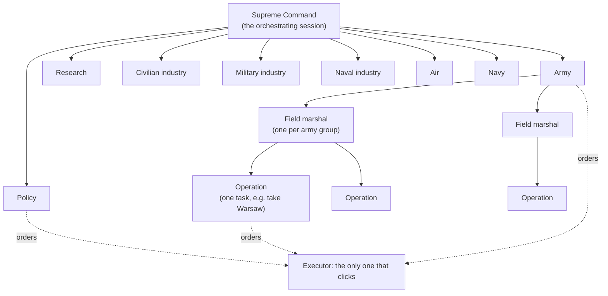

# Command structure: one agent per branch of the state

The player is split into agents that each own one area of the game, think about nothing else, and return orders.
One executor carries the orders out, because only one thing can hold the mouse. Status: design, 2026-11-09. The
build is in `QUEUE.md` (rows OR1, SR1, FP1, ST1, TH1, EX4-EX6, TL1).

## Why

Jerus, 2026-11-09: "i noticed you were making a ton of unoptimal decisions. how about you design a system were one
agent takes care of entirely the policy tab, another of the air, another of the navy, another of the civilian
industry, another of the military industry, another of the naval industry, one is the entire army, and then inside
the army agent, there is one for every field marshal. with a single agent that can be assigned for specific tasks
say to do an offensive, and that agent purely focuses on that."

What went wrong when one player did everything (docs/changelog.md, the 1939-1940 runs):

- Areas nobody looked at for weeks: all 14 air wings had no mission, research slots sat empty, the construction
  queue was empty with 42 civilian factories idle, about 1,200 political power was unspent, no focus was running.
- A front nobody owned: the French border was left to loose divisions, and France broke in within three weeks.
- Orders nobody followed up: direct army orders ended at a blocked path, and the armies dug in while the front moved.

An agent per area fixes the first two by construction: every area has an owner who looks at it every time it is due.
The operation agent fixes the third: one task, one owner, followed until it succeeds or is called off.

## The agents



| Agent | Owns (decides, and orders the executor to do) | Asks others for |
|---|---|---|
| **Supreme Command** | War aims (who to fight, when), each turn's budgets, conflicts between agents, which operations exist. Played by the orchestrating session itself, not a separate agent: it already holds every report | - |
| **Policy** | The Politics screen: national focus, laws, advisors, government slots, political decisions, diplomacy, events | Supreme Command: when to declare war |
| **Research** | All research slots | - (takes requests: each branch may ask for techs) |
| **Civilian industry** | The construction queue (factories, infrastructure, refineries, forts, air bases), trade, the civilian factory balance | - (takes requests: forts from the army, air bases from air) |
| **Military industry** | Every military-factory production line (land and air equipment), stockpile targets | - (takes requests: equipment from army and air) |
| **Naval industry** | Every dockyard line: ships and convoys | - (takes requests: ships from the navy) |
| **Air** | Every air wing: missions, regions, bases, new wings from stock | Military industry: planes. Civilian industry: air bases |
| **Navy** | Every fleet: missions, regions, convoy escort, support for naval invasions | Naval industry: ships |
| **Army** | Division templates, recruiting and deployment, which divisions go to which army group and theater, the reserve, command power for military decisions | Military industry: equipment. Civilian industry: forts |
| **Field marshal** (one per army group) | Its armies: front lines, battle plans, holding its theater; starts and ends operations in it | Army: divisions. Air: support over its regions |
| **Operation** (one per task) | Only the armies or divisions lent to it, for one goal | Its field marshal: more forces. Air: support for its battle |

Research is not in Jerus's list. It is added because research slots serve every branch, and empty slots were one of
the costliest misses; it is small and runs only when a slot frees.

## Shared resources: one owner each

Every resource has one agent that decides it. Others get some through Supreme Command's budget or a request.

| Resource | Owner | How the others get some |
|---|---|---|
| Political power | Policy | A share in the turn's budget (for example the army's command-power decisions use CP, not PP) |
| Command power | Army | Air and navy get a share in the budget |
| Civilian factories | Civilian industry | Requests for buildings; Supreme Command sets the construction vs trade split |
| Military factories | Military industry | Requests for equipment; Supreme Command sets the split between army and air |
| Dockyards | Naval industry | Requests from the navy |
| Manpower | Army | Navy and air state what new ships and wings need; Supreme Command caps each |
| Research slots | Research | Requests from every branch, ranked by Research |
| Fuel | Civilian industry (refineries, trade) | Air, navy and army report use; Supreme Command cuts missions when fuel runs low |

A request is an order addressed to an agent instead of the executor:
`{"op": "request.equipment", "to": "military_industry", "equipment": "infantry_equipment", "amount": 20000, "by": "army", "why": "16 new divisions"}`.
It reaches that agent in its next input. Budgets are numbers in every agent's input, so no two agents spend the same
point (OR1's merge step checks it anyway).

## One turn

The game is paused for the whole turn and only runs during the advance.

1. **Snapshot.** Save to `claude_state` (one save, overwritten each turn) and read it with the save reader (SR1);
   read the bridge's log lines (`hoi4.py state`, `news`).
2. **Triggers (code, no agent).** Decide who is due: an agent whose cadence is up, or one with a trigger (a research
   slot freed, a focus finished, an event open, idle factories, a new war, a lost state, an operation's goal met).
3. **Phase A, in parallel: the army tree.** Army, every field marshal, every active operation. They issue orders and
   requests (divisions, air support, equipment).
4. **Phase B, in parallel: air and navy.** They answer this turn's support requests (close air support over an
   operation's battle) and run their own missions.
5. **Phase C, in parallel: industries, research, policy.** They answer requests from A and B within their budgets.
6. **Merge.** OR1's merge step: conflicts are settled by Supreme Command (the session), never guessed.
7. **Execute.** The executor runs the orders one by one, in priority order, and checks each one (`act ...` already
   checks its own result). An order with no executor command is logged as a missing tool, which is built before
   the next turn (Jerus: "When something isnt developed for you, stop develop the tools and continue").
8. **Feedback.** Each agent's next input carries what happened to its orders: done, refused (with the game's
   reason), or failed.
9. **Advance** N days: 3-5 in war, 7-14 in peace. Stop early on a trigger the bridge sees (a war declared on us).

Agents in one phase run at once (one message with several Agent calls). A phase only waits for the one before it.

### Cadence

| Agent | In war | In peace | Also when |
|---|---|---|---|
| Operation | every turn | - | - |
| Field marshal | every turn | every 2nd turn | its front changes |
| Army | every turn | every 2nd turn | new divisions are ready |
| Air | every turn | monthly | a support request arrives |
| Navy | every 2nd turn | monthly | a fleet is attacked |
| Military and naval industry | every 3rd turn | every 3rd turn | factories idle, a request, a shortage |
| Civilian industry | every 3rd turn | every 2nd turn | the queue has idle factories |
| Research | - | - | a slot frees |
| Policy | every 3rd turn | every 2nd turn | an event opens, a focus ends, PP over 150 |

## What each agent gets and returns

Each agent is a Claude Code subagent (`.claude/agents/hoi4-<role>.md`). Its input is one JSON file, kept short:

- **brief:** its doctrine, the same every turn (in the agent file).
- **notes:** its own plan from last time, at most 20 lines (kept in `state/agents/<role>.md`, not committed).
- **state:** only its slice of the snapshot (ST1), for example the air agent gets wings, bases, regions with air
  superiority, and the fronts' regions; nothing about laws or dockyards.
- **budget:** what it may spend this turn.
- **requests:** addressed to it by other agents.
- **results:** what happened to its last orders.

It returns one JSON object: `orders` (OR1 lines, each with a one-line `why`), `requests`, `report` (at most three
lines for Supreme Command and the turn log), and `notes` (its updated plan). It never sees the screen, never names a
pixel, and never makes a decision that belongs to another agent.

## Operations

An operation is a task agent with a charter, created by a field marshal (or by the Army for a cross-theater task):

```json
{"op": "operation.start", "name": "warsaw", "goal": "Take Warsaw", "forces": ["army 3", "army 4"],
 "success": "Warsaw is controlled by GER", "abort": "deadline passed, or the armies fall under 50% strength",
 "deadline": "1939-09-30", "by": "field_marshal_east", "why": "Poland's capital: its fall gives most surrender"}
```

- Each turn it gets only its forces, the provinces around them, and the enemy units next to them. It orders only
  those forces: targets, attack lines, regrouping, and requests for air support and reinforcements.
- It ends when `success` or `abort` is true (checked by the turn loop from the snapshot), reports, and gives its
  forces back to the field marshal.
- At most three at once per field marshal, so each gets the attention it needs.

## Fair play

- Agents see what a human player could see. The save holds everything, including every enemy unit, so the state
  slicer (ST1) filters it: our own country in full; enemies only as the game shows them (division counts and
  factories in diplomacy, which the bridge already reports, and enemy units in provinces next to ours).
- Everything changes through the game's interface, never the console (`CLAUDE.md`, Standing rules).

## What it costs

An estimate, to be measured in TL1: in war a turn calls about 6-10 agents (Army, 2-3 field marshals, 0-3 operations,
Air, and on average one industry or policy agent), each with a few thousand tokens in and one or two thousand out.
A game month at war is about 6 turns, so 40-60 agent calls. That is several times what one player used, so:

- cadence and triggers keep agents asleep when nothing in their area changed;
- inputs are slices, not the whole state;
- models by weight: the army tree (Army, field marshals, operations) on the strongest model; industries, research,
  policy and navy on a cheaper one.

## What the executor can do today, and what is missing

| Agent | Executor commands that exist | Missing |
|---|---|---|
| Policy | `act focus`, `act decision`, `act idea` (laws, advisors, staff, government), `act diplomacy`, `act event` | A list of focuses that can start (FP1); faction invites and guarantees, untested |
| Research | `act research`, `act research-fill`, `read techs` | - |
| Civilian industry | `act build` (by free slots) | Building in a named state; trade (EX6) |
| Military industry | `act production --name/--line --add/--remove` | A new production line; equipment designers |
| Naval industry | - | Everything: dockyard lines (EX4) |
| Air | `read air`, `act air assign/rebase/base` | New wings from stock |
| Navy | - | Everything: fleets, missions, convoy escort (EX4) |
| Army | `act recruit`, `act fix-queue`, `act army general` | Army groups and field marshals, templates, moving divisions between armies safely (`act army new` takes divisions from other armies: EX5); deploy locations (fix-queue sets one per run) |
| Field marshal, Operation | `act army target/front/execute/push`, `act order`, `act select-box` | Attack lines by province name; which provinces each side holds (from SR1) |

## Build order

| Batch | Lane | What | After |
|---|---|---|---|
| [OR1](queue/OR1.md) | Offline | The orders format, now with requests, budgets, results and operation charters | - |
| [SR1](queue/SR1.md) | Offline | The save reader | - |
| [FP1](queue/FP1.md) | Offline | The focus planner: which focuses can start, from the game's focus files | - |
| [ST1](queue/ST1.md) | Offline | The state slicer: one input per agent, fog of war applied | SR1 |
| [TH1](queue/TH1.md) | Offline | The agent definitions, one per role, each with a worked example | OR1, ST1 |
| [EX4](queue/EX4.md) | PC | Navy and dockyards in the executor | - |
| [EX5](queue/EX5.md) | PC | Army structure: army groups, field marshals, templates, safe army forming | - |
| [EX6](queue/EX6.md) | PC | Trade, and building in a named state | - |
| [TL1](queue/TL1.md) | PC | The turn loop that runs all of it, measured over one game month | OR1, ST1, TH1 |

## Choices made here (Jerus may change them)

- Supreme Command is the orchestrating session, not one more agent.
- Research is its own agent, though it was not in the list.
- Agents see only what a player could see (Fair play).
- The army tree runs on the strongest model, the rest on a cheaper one.
